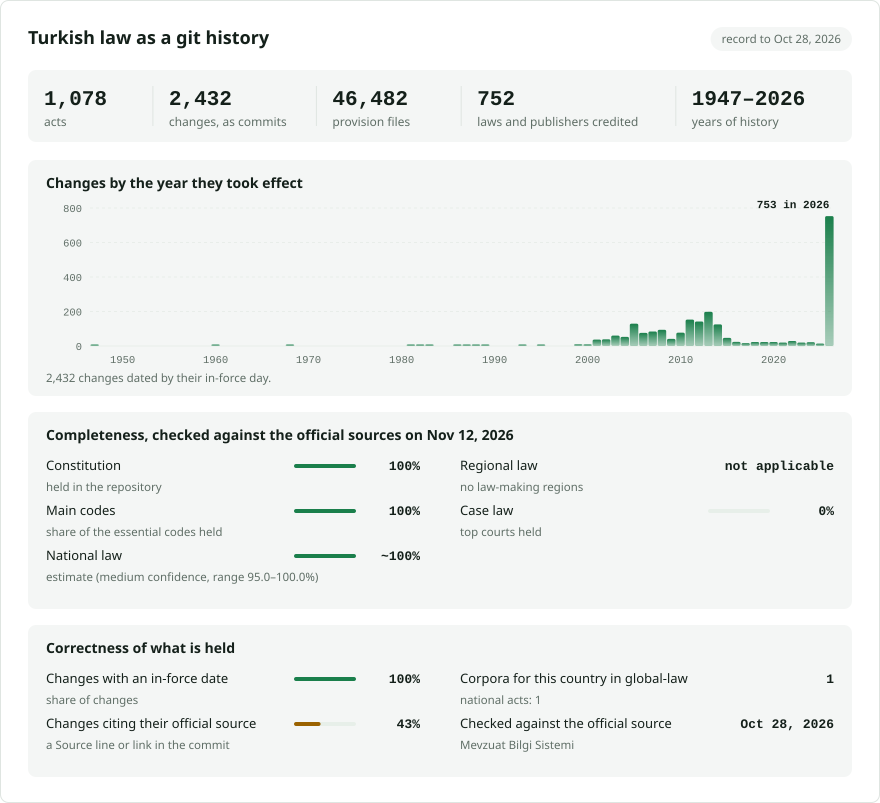

# Türkiye: law history in git

**English** · **[Ya da Türkçe okuyun](README.md)**

<picture>
<source media="(prefers-color-scheme: dark)" srcset="data/effort-dark.svg">

</picture>

The law of Türkiye as a git history: one file per article, one commit per version on the day it took effect, and the act that made each change as the commit's author. `git blame` names the act behind every line; `git log` lists every change to an article; picking a date gives the text in force that day.

Part of [lexifina/global-law](https://github.com/lexifina/global-law), one git history for every country's law: this is Türkiye's national law, which global-law reads at `turkey/national/acts/`.

**What is in it now:** Turkey's legislation: 908 laws in force (the Constitution among them; 280 with every earlier text), repealed laws and provisions, decree-laws, presidential decrees, by-laws, regulations and communiqués; more than 4,900 laws in their text as enacted; decisions of courts and regulators (Anayasa Mahkemesi, Uyuşmazlık Mahkemesi, Sayıştay, Rekabet Kurulu, RTÜK, tax rulings of the Gelir İdaresi and others); the Grand National Assembly's decisions, written questions and plenary records since 1920; about 285,000 decisions of municipal and provincial councils; and the Resmî Gazete's index, item texts and notices. [`PLAN.md`](PLAN.md) lists every part with its count and how far each one is.

Each act is one folder, `<kind>/<year>/<number>/`, with one file per article (`law/2003/4857/` is the İş Kanunu, the Labour Act, Law No. 4857, and `madde-53.md` its Article 53); the Constitution is [`law/1982/2709/`](law/1982/2709/). Decisions are folders in the same shape (`case-law/constitutional-court/norm/<year>/<number>/`). Until 2026-11-10 act folders were named by the act's id (`kanun/4857`): `git log --follow` and `git blame` cross the move, `tools/in_force_on.py` takes the id for a date before it, and [`data/paths.json`](data/paths.json) maps each id to its folder.

The text is in Turkish, as the publishers print it. An English translation is not part of this record.

## Questions as git commands

| Question | Command |
| --- | --- |
| Every change to Article 53 of the Labour Act (annual leave) | `git log --follow -p --word-diff -- law/2003/4857/madde-53.md` |
| Which act wrote each line of Article 53? | `git blame law/2003/4857/madde-53.md` |
| Every version of Article 53, with the day each took effect | `git log --follow --format="%h %(trailers:key=In-force,valueonly,separator=) %an" -- law/2003/4857/madde-53.md` |
| Article 53 as in force on 1 January 2014 | `python tools/in_force_on.py 2014-01-01 kanun/4857 madde-53` |

**Outside git**, we also host this record publicly, for free:

- **[Ask Claude about Turkish law](https://global-law.lexifina.com/v1/try_claude?country=turkey)**: opens Claude with a first question ready.
- **[Ask ChatGPT](https://global-law.lexifina.com/v1/try_chatgpt?country=turkey)**: the same question in ChatGPT.
- **[Search Turkish law on our site](https://lexifina.com/law?country=turkey&q=y%C4%B1ll%C4%B1k+izin)**: a search for "yıllık izin", with each provision's text and its versions, no account needed.
- **[Developer REST API](https://global-law.lexifina.com/v1/search_law?query=y%C4%B1ll%C4%B1k+izin&jurisdiction=turkey)**: the same search as JSON, with no key. See the [documentation here](https://lexifina.com/api/global-law).

Both assistants read the record through the free Global law connector (MCP, `https://global-law.lexifina.com/mcp`); the first time, the chat gives you the link that adds it. Ask in Turkish or in English.

**Host it yourself easily.** All it takes is git and Python, and the tools run on your machine:

```sh
git clone --depth 1 https://github.com/lexifina/global-law && cd global-law
python3 tools/countries.py add turkey/national/acts
python3 tools/law.py show 2026-01-01 turkey/national/acts/law/2003/4857/madde-53.md
```

Opened in Claude Code, Cursor, VS Code or Codex, the clone also starts a local MCP server with the same tools ([MCP.md](https://github.com/lexifina/global-law/blob/main/MCP.md)).

## Dates

Each commit carries the day its version took effect, or the day a decision was given or published, in its `In-force:` trailer, with `In-force-basis:` or `Date-source:` saying where that day comes from:

- for the 280 laws with earlier texts, the publisher's own in-force table at the end of each act ("... YÜRÜRLÜĞE GİRİŞ TARİHİNİ GÖSTERİR LİSTE"); a version whose act is in no table, and a law's first text, take the act's Resmî Gazete date;
- for an act held as its current text only, the day its commencement clause, its latest amendment printed in the text or its Resmî Gazete date gives; the 733 acts of the first build are dated the day they were retrieved, 2026-10-28;
- for a decision, the day the court or board gave it, or the Resmî Gazete published it, as the source prints it.

Most commits are dated that day at noon, Turkey time (Europe/Istanbul); the exceptions are the 28,838 before 1970, dated 1970-01-01 because git cannot store earlier dates, and 1,885 decisions added on 14 November 2026, dated that day. Ask for a date with `tools/in_force_on.py`, not `git log --before`.

Each change to an act is credited to the act that made it (`Kanun 6552`, `KHK 666`, `Anayasa Mahkemesi K. 2014/81`): 658 commits. A change no single act explains is credited to the publisher, `Mevzuat Bilgi Sistemi (T.C. Cumhurbaşkanlığı)`, as `Kind: unexplained` with its possible acts in `Candidate:` (303 commits), and typesetting alone is `Kind: editorial` (387). Decisions and other texts are credited to the body that issued them, usually with their number (`Uyuşmazlık Mahkemesi K. 2025/582`, `Rekabet Kurulu`, `GIB sirkuler 614`). Corrections are appended as their own commits (`Kind: correction`, 14 so far).

## How current it is

- [FRESHNESS.en.md](FRESHNESS.en.md): how current each source is, source by source, and how global-law sees this repository
- [WATCHING.en.md](WATCHING.en.md): every official source watched for Türkiye, what is read on it and when it was last read
- [monitoring/](monitoring/README.en.md): the state of this repository (latest commits, what arrived, what is stale), and how to keep a fork current with GitHub Actions

## How it is checked

- `tools/build/check_repo.py` read every law, KHK and CBK of the first build back from git: each current text word for word against the HTML the site serves, and each earlier version against Microsoft Word's own text of the publisher's `.doc`, with no mismatch in their characters. Two builds from the same files give the same commit hashes ([`REPRODUCE.md`](REPRODUCE.md)).
- The parts added since record the sha256 of the source files they used (`source_sha256` in their ledgers under `data/`, `Source-sha256:` in their commits) and say in each commit how its date was chosen.
- History is append-only: `main` only grows, has no merge commits, and no published commit is rewritten.
- [vulnerabilities/](vulnerabilities/README.en.md): possible drafting mistakes in Turkish law, found by global-law's detectors and checked by hand.

## What it does not show

- **Most case law.** The decisions of the Yargıtay and the lower courts, and all but 9 of the Danıştay's, cannot be read automatically and are not worked around; their unification decisions are planned from the Resmî Gazete. Individual applications to the Anayasa Mahkemesi are an index of metadata and links, with 970 decisions in full.
- **History for most acts.** Every act except the 280 laws with earlier texts starts at its current text; its earlier history is planned from the amending acts in the Resmî Gazete.
- **The other communiqués (4,284 of 4,482 are here), presidential decisions (1,740 of 4,374) and regulations of ministries and agencies, treaties and bills**, and most of the 185 repealed laws and the 170 presidential decrees no longer in force: planned parts (see `PLAN.md`).
- **Private persons.** Where a decision names a private person and the publisher does not anonymise it, only its metadata and link are here.
- **Pictures and formatting** (bold, italics, indentation). Ottoman-era dates (Rumi or Hijri) are kept as printed, not converted.

## Sources

| Source | Kind | Past versions | Notes |
| --- | --- | --- | --- |
| [Mevzuat Bilgi Sistemi](https://www.mevzuat.gov.tr) (T.C. Cumhurbaşkanlığı Hukuk ve Mevzuat Genel Müdürlüğü) | Consolidated legislation: laws, KHK, CBK, by-laws, regulations; the law index | for 280 laws, every earlier text it keeps ("Önceki metinler"); otherwise the current text | The legally binding text is the one in the Resmî Gazete |
| [Resmî Gazete](https://www.resmigazete.gov.tr) | The official gazette: the daily index of every issue | as published | Notices (ilanlar) are never stored |
| [Anayasa Mahkemesi](https://normkararlarbilgibankasi.anayasa.gov.tr) | Norm review, individual applications, political parties, Yüce Divan, immunity | as published | Individual applications as an index |
| [Uyuşmazlık Mahkemesi](https://kararlar.uyusmazlik.gov.tr), [Sigorta Tahkim Komisyonu](https://www.sigortatahkim.org) | Court decisions, arbitral awards | as published | |
| [Rekabet Kurumu](https://www.rekabet.gov.tr), [RTÜK](https://www.rtuk.gov.tr) | Board decisions | as published | Confidential parts as the publisher redacted them |
| [Gelir İdaresi Başkanlığı](https://www.gib.gov.tr) | Tax rulings (özelgeler), circulars | as published | |
| [YSK](https://www.ysk.gov.tr), [Sayıştay](https://www.sayistay.gov.tr), [TBMM](https://www.tbmm.gov.tr) | Election decisions, audit decisions, Assembly decisions | as published | |
| [Ankara](https://www.ankara.bel.tr) and [Bursa](https://www.bursa.bel.tr) Metropolitan Municipalities | Council decisions | as published | A private person named: metadata and link only |

## Licence

See [`LICENSE`](LICENSE). Article 31 of the Fikir ve Sanat Eserleri Kanunu (Law No. 5846, [`law/1951/5846/madde-31.md`](law/1951/5846/madde-31.md)) makes the reproduction, distribution, adaptation and any other use of officially published or announced laws, presidential decrees, regulations, communiqués, circulars and judicial decisions free. Lexifina's own contributions (the tools, the arrangement and the commit messages) are CC0 1.0.

No AI model wrote or changed legal text; the scripts were written by AI models (see [`REPRODUCE.md`](REPRODUCE.md)).

## Visualisations

[visualisations/](visualisations/): Turkish law in 20 charts, drawn from this repository.

Including:

- How many laws the Grand National Assembly passes, what they are about, and omnibus laws
- States of emergency, troop mandates and how the laws in force change
- The Official Gazette, metropolitan councils and the Constitutional Court

## More

From [lexifina/global-law](https://github.com/lexifina/global-law):

- [FEATURES.md](https://github.com/lexifina/global-law/blob/main/FEATURES.md): every feature, and what every corpus must support (`git blame`, `law.py`, the MCP tools)
- [FAQ.md](https://github.com/lexifina/global-law/blob/main/FAQ.md): questions and answers · [CONTRIBUTING.md](https://github.com/lexifina/global-law/blob/main/CONTRIBUTING.md): proposing changes · [MCP.md](https://github.com/lexifina/global-law/blob/main/MCP.md): the MCP server · [REPRODUCE.md](https://github.com/lexifina/global-law/blob/main/REPRODUCE.md): how it was built · [CHANGELOG.md](https://github.com/lexifina/global-law/blob/main/CHANGELOG.md)
- [FRESHNESS.md](https://github.com/lexifina/global-law/blob/main/FRESHNESS.md): how current each corpus is · [Monitoring](https://github.com/lexifina/global-law/tree/main/monitoring): whether updates are running · [WATCHING.md](https://github.com/lexifina/global-law/blob/main/WATCHING.md): how each official source is watched for changes
- [performance/](https://github.com/lexifina/global-law/tree/main/performance): how fast the tools are, measured
- [visualisations/](https://github.com/lexifina/global-law/tree/main/visualisations): charts and bridges across the world's law
- [Vulnerabilities](https://github.com/lexifina/global-law/tree/main/vulnerabilities): mistakes in legislation as published
