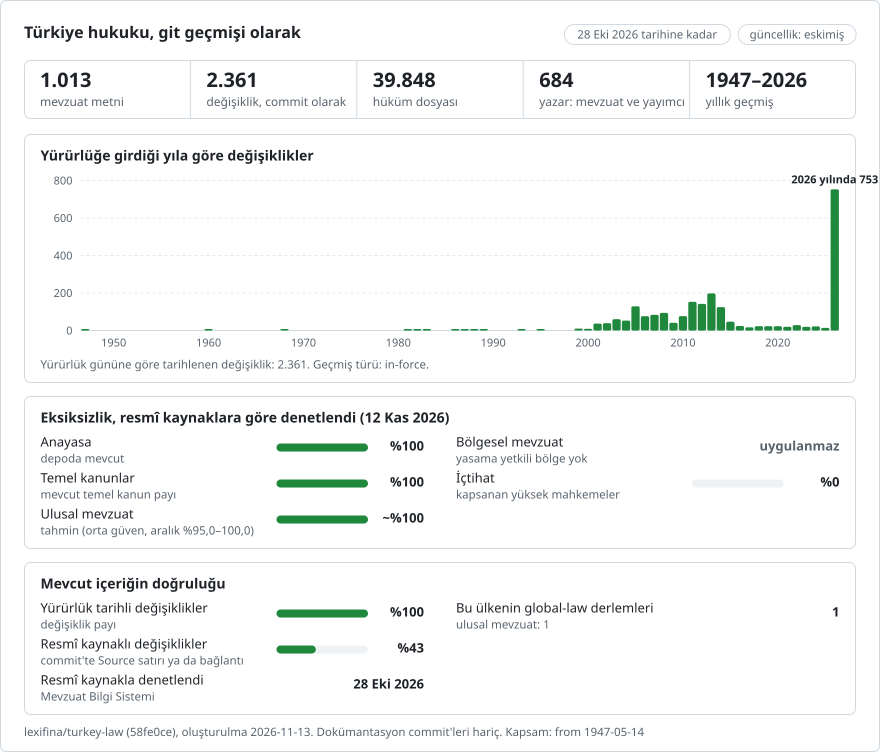

# Türkiye'nin kanunları, bir git deposu olarak

**Türkçe** · [English](README.en.md)

<picture>
<source media="(prefers-color-scheme: dark)" srcset="data/tr/effort-dark.svg">

</picture>

Her ülkenin hukuku için tek bir git geçmişi olan [lexifina/global-law](https://github.com/lexifina/global-law) projesinin parçası: bu, global-law'un `turkey/national/acts/` yolunda okuduğu Türkiye ulusal mevzuatıdır.

Türkiye'nin yürürlükteki kanun düzeyindeki mevzuatı, bir git deposu olarak: 908 kanun (Anayasa, `kanun/2709`, ile Türk Medeni Kanunu `kanun/4721`, Türk Borçlar Kanunu `kanun/6098` ve Türk Ceza Kanunu `kanun/5237` gibi temel kanunlar dahil), hâlâ yürürlükte olan 9 Osmanlı dönemi kanunu (`osmanli/`), 63 kanun hükmünde kararname (KHK, `khk/`) ve 33 Cumhurbaşkanlığı kararnamesi (`cbk/`). Kaynak: T.C. Cumhurbaşkanlığı Hukuk ve Mevzuat Genel Müdürlüğünün yürüttüğü resmî [Mevzuat Bilgi Sistemi](https://www.mevzuat.gov.tr). Her madde bir dosyadır (36.955 madde dosyası) ve her satırda bir paragraf bulunur; böylece `git blame` ve `git diff` satır satır çalışır. Metin Türkçedir ve tam olarak yayımlandığı hâliyledir.

**280 kanun için geçmiş; diğerleri için yalnızca güncel metin.** Anayasa (`kanun/2709`, 1982 metninden itibaren) dahil 280 kanun için yayıncı, önceki konsolide metinleri ("Önceki metinler", Word dosyaları) saklamaktadır. Bunların her biri burada bir sürümdür: 1947-05-14'ten itibaren 1.187 önceki sürüm ve güncel metin. İki sürüm arasında değişen her madde, değişikliği yapan değiştirici düzenlemeye, yürürlüğe girdiği gün atfedilir; bu belirlenemediğinde ise işaretlenir (aşağıya bakınız). Liste [`data/history-laws.csv`](data/history-laws.csv) dosyasındadır; her sürüm etiketlenmiştir (`git tag -l 'kanun/2709/*'`) ve [`data/versions.csv`](data/versions.csv) dosyasında listelenir. Diğer 733 düzenlemenin her birinin tek bir commit'i vardır: 2026-10-28'de yayımlandığı hâliyle güncel metinleri; o günden önceki geçmişleri yoktur. Her düzenlemede yayıncının `(Değişik: 3/10/2001-4709/6 md.)` (3 Ekim 2001 tarihli 4709 sayılı Kanunun 6. maddesiyle değiştirilmiş) gibi değişiklik notları metinde kalır ve [`data/amendments.csv`](data/amendments.csv) dosyasında listelenir (1.551 değiştirici düzenlemeyi anan 20.203 not); dipnotlar her düzenlemenin `dipnotlar.md` dosyasındadır.

## Bir hukukçunun soruları git komutları olarak

| Soru | Komut |
| --- | --- |
| Anayasanın 21. maddesi bugün ne diyor? | `python tools/in_force_on.py 2026-10-28 kanun/2709 madde-21` |
| 1 Ocak 2000'de ne diyordu? | `python tools/in_force_on.py 2000-01-01 kanun/2709 madde-21` |
| Onu hangi düzenlemeler değiştirdi ve her biri ne zaman yürürlüğe girdi? | `git log --format='%(trailers:key=In-force,valueonly,separator=) %an' -- kanun/2709/madde-21.md` |
| Bir değişiklik tam olarak neyi değiştirdi? | `git log -p --word-diff --author='Kanun 4709' -- kanun/2709` |
| Bir maddenin her satırını hangi düzenleme yazdı? | `git blame kanun/2709/madde-21.md` |
| Bir değiştirici düzenlemenin tüm kanunlarda değiştirdiği her şey (burada 6525 sayılı Kanun) | `git log --stat --author='Kanun 6525'` |
| Bir düzenlemenin bir tarihteki tamamı, sırasıyla | `python tools/in_force_on.py 2010-01-01 kanun/2547` |
| Bir düzenlemenin yayıncıdaki sürümleri | `git tag -l 'kanun/2709/*'` |
| Hangi kanunların geçmişi var | [`data/history-laws.csv`](data/history-laws.csv) |
| Bir değiştirici düzenlemenin notlarında adı geçen her madde (tüm düzenlemelerde) | `grep ',6771,' data/amendments.csv` |
| Her değiştirici düzenlemenin yürürlüğe giriş tarihi, düzenleme bazında | `grep '^kanun/5237,' data/in-force-list.csv` |
| Türk Ceza Kanununa atıf yapan düzenlemeler | `git grep -l '5237 sayılı'` |
| Tarihleri ve Resmî Gazete sayılarıyla düzenlemelerin listesi | [`laws.csv`](laws.csv) |

Dosyalar: her düzenleme için `<kind>/<number>/`. `baslangic.md` başlığı, numaraları (Kanun Numarası, Kabul Tarihi, Resmî Gazete, Düstur) ve ilk maddeden önceki her şeyi içerir. Maddeler başlıklarına göre adlandırılır: `madde-21.md` (Madde 21), `madde-4a.md` (Madde 4/A), `ek-madde-3.md` (Ek Madde 3), `gecici-madde-1.md` (Geçici Madde 1), `ek-gecici-madde-2.md`. Bir maddenin hemen önünde yer alan bölüm başlıkları (KISIM, BÖLÜM) ve madde kenar başlıkları, o maddenin dosyasının ilk satırlarıdır. `Bend` ile numaralandırılmış Osmanlı dönemi düzenlemelerinde `bend-21.md` bulunur. Bir düzenlemede iki kez geçen bir başlık `~2`, `~3` alır. Yayıncının bir düzenlemenin arkasına eklediği bölümler ayrı dosyalardır: `islenemeyen-hukumler.md` ("... KANUNA İŞLENEMEYEN HÜKÜMLER", değiştirici düzenlemelerin metne işlenemeyen hükümleri) ve `yururluk-listesi.md` ("... YÜRÜRLÜĞE GİRİŞ TARİHİNİ GÖSTERİR LİSTE", her değiştirici düzenlemenin veya Anayasa Mahkemesi iptal kararının ne zaman yürürlüğe girdiği). Son maddeden sonra gelen ekli cetveller o maddenin dosyasında kalır. Kanun numarası iki Düstur tertibinde kullanılmış düzenlemelerde yenisi yalın numarayı, eskisi `-t3` ekini taşır. `dipnotlar.md` yayıncının dipnotlarını her satırda bir dipnot olacak şekilde içerir; `index.txt` okuma sırasını verir. Tablo satırları, hücreleri ` | ` ile birleştirilmiş tek bir satırdır.

## Tarihler ve hangisini kullandığımız

**Değişiklikler yürürlüğe girdikleri günle tarihlendirilir**; saat, Türkiye saatiyle öğlen 12'dir (7 Eylül 2016'dan beri UTC+3; öncesinde yaz saati uygulamasıyla birlikte UTC+2) ve tarih `In-force:` trailer'ında ve commit tarihi olarak yer alır. Tarih, yayıncının her düzenlemenin sonundaki kendi yürürlük tablosundan ("... YÜRÜRLÜĞE GİRİŞ TARİHİNİ GÖSTERİR LİSTE": değiştirici düzenleme | maddeler | yürürlük tarihi), düzenlemeyi listeleyen en yeni metinden alınır; tablo bir düzenleme için birden fazla tarih verdiğinde maddeyi anan satır kullanılır (`Date-source: in-force-table`). Tablo, değişikliğin yürürlüğe girmesinden önceki bir günden itibaren uygulanacağını belirttiğinde ("1/1/2008 tarihinden geçerli olmak üzere 8/5/2008"), o gün bir `Applies-from:` trailer'ıdır. Düzenlemesi hiçbir tabloda yer almayan bir sürüm, düzenlemenin Resmî Gazete tarihiyle tarihlendirilir (`Date-source: published`); bir kanunun kendi ilk metni ("Kanunun ilk hali") de öyle. 1970'ten önceki tarihler git'te 1970-01-01'e sabitlenir; gerçek tarih `In-force:` içindedir. Değişiklik notlarının içindeki tarihler (`7/5/2010-5982/2 md.`) kabul tarihleridir ve hiçbir zaman yürürlük tarihi olarak kullanılmaz. 717 düzenleme yürürlük tablosu içerir ([`data/in-force-list.csv`](data/in-force-list.csv) dosyasında 8.721 satır).

Geçmişi olmayan düzenlemeler, metnin alındığı gün olan 2026-10-28 ile tarihlendirilir: yayıncıya göre o gün yürürlükte olan metin. Her düzenlemenin ilk commit'i ayrıca `Enacted:` (kabul tarihi), `Published:` (Resmî Gazete tarihi) ve `Gazette:` trailer'larını taşır.

`tools/in_force_on.py DATE PATH [ARTICLE]` `In-force:` trailer'larını okur; bu nedenle (`git rev-list --before` komutundan farklı olarak) saat diliminize bağlı değildir. Bir düzenlemenin ilk sürümünden önceki bir tarih için sürüm bulunmadığını söyler. Yürürlük tarihi 2026-10-28'den sonra olan değişiklikler `future` dalındadır (1 commit), hiçbir zaman `main` dalında değildir.

## "Yazar" ne demektir

- **Değiştirici bir düzenleme** (`Kanun 6525 (...) <kanun-6525@mevzuat-gov-tr.invalid>`, `KHK 666`, `Anayasa Mahkemesi K. 2013/43`; bu adresler var olamaz), `Kind: amendment`: madde yayıncının iki metni arasında değişmiştir ve bunu tam olarak bir düzenleme açıklar; çünkü ya o maddeye eklenen yeni bir değişiklik notu düzenlemeyi anar ya da (not eklenmemişse) düzenlemenin yürürlük tablosundaki satırı maddeyi listeler. `Evidence:` her dosya için hangisi olduğunu belirtir. 658 commit, 4.804 dosya değişikliği.
- **Yayıncı** (`Mevzuat Bilgi Sistemi (T.C. Cumhurbaşkanlığı)`), `Kind: unexplained`: hiçbir düzenlemenin açıklamadığı ya da birden fazla düzenlemenin açıkladığı veya düzenlemesinin o adımda kullanılabilir bir yürürlük tarihi bulunmayan değişiklik. Bunlar işaretlenir ve hiçbir zaman bir düzenlemeye atfedilmez; `Candidate:` olası düzenlemeleri adlandırır, `Reason:` nedenini belirtir. Birçoğu yayıncının metinler arasındaki kendi düzeltmeleri ve hatalarıdır (notu olmayan değişmiş bir sözcük); son adım, yani en yeni önceki metinden güncel metne geçiş ise çoğu zaman birkaç düzenlemeyi birden kapsar. 303 commit, 13.517 dosya değişikliği.
- **Yayıncı**, `Kind: editorial`: yalnızca dizgi (boşluklar, tireler, tırnak işaretleri, dipnot numaraları, bir sonraki maddeye taşınan bir başlık) ve yayıncının eklediği yardımcı unsurlar (dipnotlar, yürürlük listesi, işlenemeyen hükümler). Kanun metninin hiçbir sözcüğü değişmez. 387 commit.
- **Bir kanunun ilk metni**: yayıncının en eski metni kanunun ilk yayımlandığı hâli olduğunda yazar kanunun kendisidir (`Kind: enacted`), aksi takdirde yayıncıdır (`Kind: consolidated`, `Consolidated-by:` ile). 280 commit.
- **Geçmişi olmayan bir düzenlemenin güncel metni**: yayıncı, `Kind: consolidated`. 733 commit.

Bir commit, tek bir yürürlük gününde, değiştirdiği tüm kanunlar genelinde tek bir değiştirici düzenlemedir. Blame paragrafları bütün olarak atfeder; sözcükler için `git log -p --word-diff` kullanın.

## Neleri göstermez

- Önceki metinleri olmayan düzenlemelerin geçmişi (733 düzenleme): 2026-10-28'den öncesine ait hiçbir şey.
- Yayıncının saklamadığı adımlar: iki sürüm arasında birkaç düzenleme bulunabilir ve bu durumda birden fazla düzenlemenin açıklayabileceği değişiklikler bir düzenlemeye atfedilmez, işaretlenir.
- Yönetmelikler, tüzükler, tebliğler ve Cumhurbaşkanı kararları; mülga kanunlar.
- Osmanlı dönemi tarihleri (Rumi veya Hicri takvim) dönüştürülmez: bu commit'ler `Enacted:` ve `Published:` yerine `Enacted-as-printed:` ve `Published-as-printed:` taşır.
- Resimler ve biçimlendirme (kalın, italik, girinti). Symbol yazı tipindeki bir karakter, sitede olduğu gibi yazı tipi koduyla görünür (örneğin ″ için `²`).
- Okunamayan metinler ([`data/unreadable.csv`](data/unreadable.csv) dosyasında 0 satır).

Bu bir araştırma aracıdır. Esas alınacak metin, Resmî Gazete'de yayımlanan metindir.

## Nasıl denetlenir

Yayımlanmadan önce `tools/build/check_repo.py` her düzenlemeyi git'ten geri okudu ve karşılaştırdı:
- her düzenlemenin güncel metnini, sözcüğü sözcüğüne, sitenin sunduğu HTML ile (metin yalnızca blok sınırlarında boşlukla birleştirilerek);
- her önceki sürümü, kendi etiketinde, kaynak `.doc` dosyasının Microsoft Word'ün kendisinin ürettiği düz metniyle (gövde ve dipnotlar; derlemenin kullandığı HTML üzerinden değil, Word aracılığıyla okunarak). Dipnot işaretleri her iki tarafta da dışarıda bırakılır. Word'ün HTML'i liste numaralarından sonraki birkaç sekmeyi düşürdüğünden bu sürümler karakter karakter eşleşir ama sözcük sözcük eşleşmez; bunların sayısı verilmiştir;
- her commit'in trailer'ları `git interpret-trailers` ile ayrıştırılabilir; `main` dalında birleştirme (merge), geriye giden tarih ve derleme gününden sonraki tarih yoktur; `tools/in_force_on.py` örnek yollar için doğru maddeyi verir; aynı alınmış dosyalardan yapılan iki derleme aynı HEAD'i verir.

Sonuçlar [`REPRODUCE.md`](REPRODUCE.md) dosyasındadır.

## Nasıl oluşturulur

Kayıt; sitenin kendi arama tablosunu (`/Anasayfa/MevzuatDatatable`), her düzenlemenin metnini (`/anasayfa/MevzuatFihristDetayIframe`, sitenin gösterdiği, Word ile üretilmiş HTML), bulunduğu durumlarda önceki metinlerin listesini (`/EskiKanunlar/EskiKanunlarList`) ve bu önceki metinleri `.doc` dosyaları olarak (`/MevzuatMetin/<...>.doc`) kullanır. `convert_doc.ps1` her `.doc` dosyasını Microsoft Word'de açar ve sitenin sunduğu türden Word HTML'i olarak kaydeder; ayrıca denetim için Word'ün düz metnini de kaydeder. `build.py` her metni madde başlıklarından böler (tırnak içindeki başlıkları yok sayarak), `history.py` ardışık sürümleri karşılaştırır ve her değişikliği bir düzenlemeye atfeder ya da işaretler; tek bir `git fast-import` akışı hepsini yazar. Oluşturma veya denetleme sürecinde hiçbir yapay zekâ modeli yer almaz. Bkz. [`REPRODUCE.md`](REPRODUCE.md) ve [`SOURCES.md`](SOURCES.md).

## Lisans

Kaynak: Mevzuat Bilgi Sistemi, https://www.mevzuat.gov.tr, T.C. Cumhurbaşkanlığı Hukuk ve Mevzuat Genel Müdürlüğü. Resmî olarak yayımlanan kanunlar Türkiye'de serbestçe kullanılabilir: mevzuat.gov.tr'de yayımlandığı hâliyle Fikir ve Sanat Eserleri Kanununun (5846 sayılı Kanun, FSEK) 31. maddesi (`kanun/5846/madde-31.md`) şöyledir: "Resmen yayımlanan veya ilan olunan kanun, Cumhurbaşkanlığı kararnamesi, yönetmelik, tebliğ, genelge ve kazai kararların çoğaltılması, yayılması, işlenmesi veya her hangi bir suretle bunlardan faydalanma serbesttir." Sitenin altbilgisinde "Tüm Hakları Saklıdır" ifadesi yer alır ve bir gizlilik, kullanım ve telif hakkı bildirimine atıf yapılır. Bu bildirim 2026-10-28'de bulunamadı (adresi Cumhurbaşkanlığının ana sayfasına yönlendiriyor); bu nedenle koşulları okunmamıştır. Altbilgi, FSEK m. 31'in kanun metninin kendisine tanıdığı serbest kullanımı ortadan kaldıramaz; sitenin kendi materyalini (tasarım, yazılım, editoryal notlar) kapsıyor olabilir. Sitenin kendi tanıtımında hizmetin ücretsiz ve koşulsuz sunulduğu belirtilir ("ücretsiz ve koşulsuz olarak herkesin kullanımına sunulmuştur"). Metnin ifadesi değiştirilmemiş, yalnızca dosyalara ve satırlara bölünmüştür. **Bu depo özeldir.** Lexifina'nın kendi katkıları (araçlar, içeriğin düzenlenişi ve commit mesajları) CC0 kapsamındadır. Bkz. [`LICENSE`](LICENSE).

Bu metin İngilizce sürümün ([README.en.md](README.en.md)) çevirisidir; aralarında fark olursa İngilizce sürüm geçerlidir.

## Daha fazla

[lexifina/global-law](https://github.com/lexifina/global-law) deposundan (İngilizce):

- [FEATURES.md](https://github.com/lexifina/global-law/blob/main/FEATURES.md): tüm özellikler ve her derlemin desteklemesi gerekenler (`git blame`, `law.py`, MCP araçları)
- [FAQ.md](https://github.com/lexifina/global-law/blob/main/FAQ.md): sorular ve yanıtlar · [CONTRIBUTING.md](https://github.com/lexifina/global-law/blob/main/CONTRIBUTING.md): değişiklik önermek · [MCP.md](https://github.com/lexifina/global-law/blob/main/MCP.md): MCP sunucusu · [REPRODUCE.md](https://github.com/lexifina/global-law/blob/main/REPRODUCE.md): nasıl oluşturulduğu · [CHANGELOG.md](https://github.com/lexifina/global-law/blob/main/CHANGELOG.md)
- [FRESHNESS.md](https://github.com/lexifina/global-law/blob/main/FRESHNESS.md): her derlemin ne kadar güncel olduğu · [İzleme](https://github.com/lexifina/global-law/tree/main/monitoring): güncellemelerin çalışıp çalışmadığı · [WATCHING.md](https://github.com/lexifina/global-law/blob/main/WATCHING.md): her resmî kaynağın değişiklikler için nasıl izlendiği
- [performance/](https://github.com/lexifina/global-law/tree/main/performance): araçların ölçülmüş hızı
- [visualisations/](https://github.com/lexifina/global-law/tree/main/visualisations): tüm dünya hukuku genelinde grafikler ve bağlantılar
- [Zafiyetler](https://github.com/lexifina/global-law/tree/main/vulnerabilities): yayımlandığı hâliyle mevzuattaki hatalar
