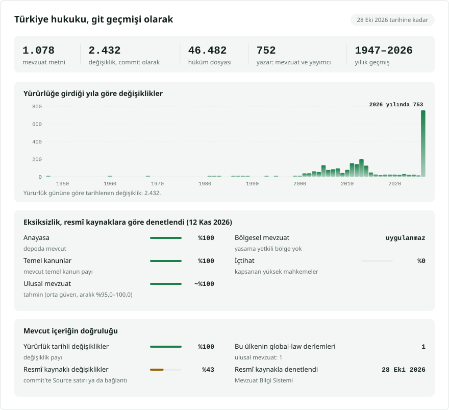

# Türkiye: git'te hukukun geçmişi

**Türkçe** · **[Or read it in English](README.en.md)**

<picture>
<source media="(prefers-color-scheme: dark)" srcset="data/tr/effort-dark.svg">

</picture>

Türkiye hukuku bir git geçmişi olarak: her madde bir dosya, her sürüm yürürlüğe girdiği gün bir commit ve değişikliği yapan düzenleme commit'in yazarı. `git blame` her satırın arkasındaki düzenlemeyi adlandırır; `git log` bir maddenin her değişikliğini listeler; bir tarih seçmek o gün yürürlükte olan metni verir.

Her ülkenin hukuku için tek bir git geçmişi olan [lexifina/global-law](https://github.com/lexifina/global-law) projesinin parçası: bu, global-law'un `turkey/national/acts/` yolunda okuduğu Türkiye ulusal hukukudur.

**Şu anda içerdikleri:** Anayasa dahil yürürlükteki 908 kanun (bunların 280 tanesi yayıncının sakladığı tüm önceki metinleriyle) ve 63 mülga kanun; hâlâ yürürlükte olan 9 Osmanlı dönemi kanunu, 63 kanun hükmünde kararname (KHK), 33 Cumhurbaşkanlığı kararnamesi (CBK) ve 105 tüzük; 3.296 yönetmelik (109 üniversite ve enstitünün 3.149 yönetmeliği, Bakanlar Kurulunun 147 yönetmeliği); Anayasa Mahkemesinin 1.396 norm denetimi kararı, siyasi partiler, yasama dokunulmazlığı ve Yüce Divan hakkındaki 1.965 kararı ve 17.999 bireysel başvuru kararının dizini; Uyuşmazlık Mahkemesinin 414 kararı, 120 sigorta tahkim kararı ve Rekabet Kurulunun 1.997 kararı; Yüksek Seçim Kurulunun 455 kararı, 7 Sayıştay kararı ve Türkiye Büyük Millet Meclisinin 9 kararı; Ankara'nın 246 ve Bursa'nın 18 meclis kararı; 2001'den bu yana 7.028 günün Resmî Gazete fihristi (70.885 öğe) ve bugüne kadar kabul edilmiş 15.623 kanunun tamamının dizini. [`PLAN.md`](PLAN.md) bu deponun içermesi gereken her bölümü ve her birinin ne kadar ilerlediğini listeler (şu ana kadar %41,1); birkaç bölüm şu anda dolduruluyor, bu yüzden bu sayılar 2026-11-14 tarihli `83881dfc4e` commit'inin sayılarıdır.

Her düzenleme bir klasördür, `<tür>/<yıl>/<sayı>/`, ve her maddesi bir dosyadır (`law/2003/4857/` 4857 sayılı İş Kanunudur); Anayasa [`law/1982/2709/`](law/1982/2709/) klasöründedir. Maddeler başlıklarına göre adlandırılır (`madde-21.md`, `ek-madde-3.md`, `gecici-madde-1.md`); `baslangic.md` başlığı ve numaraları, `dipnotlar.md` yayıncının dipnotlarını içerir. Kararlar da aynı biçimde klasörlerdir (`case-law/constitutional-court/norm/<yıl>/<sayı>/`). 2026-11-10'a kadar düzenleme klasörleri düzenlemenin kimliğiyle adlandırılıyordu (`kanun/2709`); `git log --follow` ve `git blame` bu taşımayı izler, [`data/paths.json`](data/paths.json) her kimliği klasörüne eşler.

Metin Türkçedir, yayıncıların bastığı gibidir. İngilizce çeviri bu kaydın parçası değildir.

## Git komutları olarak sorular

| Soru | Komut |
| --- | --- |
| İş Kanununun 53. maddesindeki (yıllık ücretli izin) her değişiklik | `git log --follow -p --word-diff -- law/2003/4857/madde-53.md` |
| 53. maddenin her satırını hangi düzenleme yazdı? | `git blame law/2003/4857/madde-53.md` |
| 53. maddenin her sürümü, her birinin yürürlüğe girdiği günle | `git log --follow --format="%h %(trailers:key=In-force,valueonly,separator=) %an" -- law/2003/4857/madde-53.md` |
| Anayasanın 21. maddesi, 1 Ocak 2000'de yürürlükte olduğu hâliyle | `python tools/in_force_on.py 2000-01-01 kanun/2709 madde-21` |

**Git dışında** bu kaydı herkese açık ve ücretsiz olarak da sunuyoruz:

- **[Türk hukukunu Claude'a sorun](https://global-law.lexifina.com/v1/try_claude?country=turkey)**: Claude'u ilk sorusu hazır olarak açar.
- **[ChatGPT'ye sorun](https://global-law.lexifina.com/v1/try_chatgpt?country=turkey)**: aynı soru ChatGPT'de.
- **[API'yi tarayıcınızda çağırın](https://global-law.lexifina.com/v1/search_law?query=y%C4%B1ll%C4%B1k+izin&jurisdictions=turkey)**: Türk hukukunda "yıllık izin" araması, JSON olarak. Belgeler [burada](https://lexifina.com/api/global-law).

İki asistan da kaydı ücretsiz Global law bağlayıcısı üzerinden okur (MCP, `https://global-law.lexifina.com/mcp`); ilk seferde sohbet size bağlayıcıyı ekleyen bağlantıyı verir. Türkçe ya da İngilizce sorun.

**Kolayca kendiniz barındırın.** Git ve Python yeterlidir; araçlar kendi bilgisayarınızda çalışır:

```sh
git clone --depth 1 https://github.com/lexifina/global-law && cd global-law
python3 tools/countries.py add turkey/national/acts
python3 tools/law.py show 2026-01-01 turkey/national/acts/law/2003/4857/madde-53.md
```

Claude Code, Cursor, VS Code ya da Codex'te açıldığında klon aynı araçlarla yerel bir MCP sunucusu da başlatır ([MCP.md](https://github.com/lexifina/global-law/blob/main/MCP.md)).

## Tarihler

Her commit, sürümün yürürlüğe girdiği ya da kararın verildiği gün, Türkiye saatiyle (Europe/Istanbul) öğlen 12'de tarihlenir ve bu günü `In-force:` trailer'ında taşır (`In-force-basis:` ya da `Date-source:` günün nereden geldiğini söyler):

- önceki metinleri olan kanunlarda yayıncının her düzenlemenin sonundaki kendi yürürlük tablosu ("... YÜRÜRLÜĞE GİRİŞ TARİHİNİ GÖSTERİR LİSTE"); düzenlemesi hiçbir tabloda olmayan bir sürüm ve bir kanunun ilk metni düzenlemenin Resmî Gazete tarihini alır;
- yalnızca güncel metni olan bir düzenlemede metnin alındığı gün; yanında `Enacted:`, `Published:` ve `Gazette:` bulunur;
- bir kararda, mahkemenin ya da kurulun bastığı karar günü;
- git 1970'ten önceki tarihleri saklayamaz; bu nedenle daha eski 811 commit 1970-01-01 tarihlidir ve gerçek gün `In-force:` içindedir. Bir tarihi `git log --before` ile değil, `tools/in_force_on.py` ile sorun.

Her değişiklik onu yapan düzenlemeye atfedilir (`Kanun 6552`, `KHK 666`, `Anayasa Mahkemesi K. 2013/43`): 658 commit. Hiçbir düzenlemenin tek başına açıklamadığı bir değişiklik yayıncıya, `Mevzuat Bilgi Sistemi (T.C. Cumhurbaşkanlığı)`, `Kind: unexplained` olarak ve olası düzenlemeler `Candidate:` içinde verilerek atfedilir (303 commit); yalnızca dizgi değişiklikleri `Kind: editorial` olarak işaretlenir (387). Düzeltmeler ayrı commit'ler olarak eklenir (`Kind: correction`, şu ana kadar 14) ve `future` dalı daha sonra yürürlüğe girecek sürümleri içerir.

## Ne kadar güncel

- [FRESHNESS.md](FRESHNESS.md): her kaynağın ne kadar güncel olduğu, kaynak kaynak, ve global-law'un bu depoyu nasıl gördüğü
- [WATCHING.md](WATCHING.md): Türkiye için izlenen her resmî kaynak, onda neyin okunduğu ve en son ne zaman okunduğu
- [monitoring/](monitoring/): bu deponun durumu (son commit'ler, neler geldi, neler gecikti) ve bir fork'un GitHub Actions ile nasıl güncel tutulacağı

## Nasıl denetlenir

- `tools/build/check_repo.py` her kanunu, KHK'yi ve CBK'yi git'ten geri okudu: her güncel metni sitenin sunduğu HTML ile sözcüğü sözcüğüne, her önceki sürümü yayıncının `.doc` dosyasının Microsoft Word'ün kendisinin ürettiği metniyle karşılaştırdı. Sonuçlar [`REPRODUCE.md`](REPRODUCE.md) dosyasındadır.
- O zamandan beri eklenen her bölüm, kullandığı her kaynak dosyanın özetini (`data/` altındaki defterinde `source_sha256`) kaydeder ve her commit'te tarihin nasıl seçildiğini söyler (`In-force-basis:`).
- Geçmiş yalnızca eklenerek büyür: `main` dalı yalnızca büyür ve yayımlanmış hiçbir commit yeniden yazılmaz.
- [vulnerabilities/](vulnerabilities/): Türk mevzuatındaki olası yazım hataları. Planlandı; depo tamamlandığında hazırlanacak.

## Neleri göstermez

- **İçtihadın çoğu.** Yargıtay, Danıştay ve alt mahkemelerin kararları otomatik olarak okunamıyor (bir zaman aşımı ve her aramada reCAPTCHA) ve bu engeller aşılmıyor; içtihadı birleştirme kararları Resmî Gazete'den alınmak üzere planlandı. Anayasa Mahkemesine bireysel başvurular, Mahkemenin yalnızca başvurucunun baş harflerini yayımladığı durumlar dışında, üst veri ve bağlantılardan oluşan bir dizindir.
- **Çoğu düzenlemenin geçmişi.** Kanunlardan 280 tanesi yayıncının sakladığı tüm önceki metinlere sahiptir; diğer her düzenleme alındığı hâliyle başlar ve yönetmeliklerin yalnızca güncel metni vardır. Geçmişleri Resmî Gazete'deki değiştirici düzenlemelerden alınmak üzere planlandı.
- **Tebliğler, yönetmeliklerin çoğu, Cumhurbaşkanı kararları, milletlerarası andlaşmalar ve kanun teklifleri.** Planlanan bölümler (bkz. `PLAN.md`).
- **Özel kişiler.** Bir karar özel bir kişiyi adlandırıyor ve yayıncı bunu anonimleştirmiyorsa burada yalnızca üst verisi ve bağlantısı vardır.
- **Resimler ve biçimlendirme** (kalın, italik, girinti). Osmanlı dönemi tarihleri (Rumi ya da Hicri) dönüştürülmez, basıldığı gibi tutulur.

Bu bir araştırma aracıdır. Esas alınacak metin, Resmî Gazete'de yayımlanan metindir.

## Kaynaklar

| Kaynak | Tür | Önceki sürümler | Notlar |
| --- | --- | --- | --- |
| [Mevzuat Bilgi Sistemi](https://www.mevzuat.gov.tr) (T.C. Cumhurbaşkanlığı Hukuk ve Mevzuat Genel Müdürlüğü) | Konsolide mevzuat: kanunlar, KHK, CBK, tüzükler, yönetmelikler; kanun dizini | 280 kanun için sakladığı tüm önceki metinler ("Önceki metinler"); diğerleri için güncel metin | Hukuken bağlayıcı metin Resmî Gazete'deki metindir |
| [Resmî Gazete](https://www.resmigazete.gov.tr) | Resmî gazete: her sayının günlük fihristi | yayımlandığı gibi | İlanlar hiçbir zaman saklanmaz |
| [Anayasa Mahkemesi](https://normkararlarbilgibankasi.anayasa.gov.tr) | Norm denetimi, bireysel başvuru, siyasi partiler, Yüce Divan, yasama dokunulmazlığı | yayımlandığı gibi | Bireysel başvurular bir dizin olarak |
| [Uyuşmazlık Mahkemesi](https://kararlar.uyusmazlik.gov.tr), [Sigorta Tahkim Komisyonu](https://www.sigortatahkim.org) | Mahkeme kararları, hakem kararları | yayımlandığı gibi | |
| [Rekabet Kurumu](https://www.rekabet.gov.tr), [RTÜK](https://www.rtuk.gov.tr) | Kurul kararları | yayımlandığı gibi | Gizli bölümler yayıncının kararattığı gibi |
| [YSK](https://www.ysk.gov.tr), [Sayıştay](https://www.sayistay.gov.tr), [TBMM](https://www.tbmm.gov.tr) | Seçim kararları, Sayıştay kararları, Meclis kararları | yayımlandığı gibi | |
| [Ankara](https://www.ankara.bel.tr) ve [Bursa](https://www.bursa.bel.tr) Büyükşehir Belediyeleri | Meclis kararları | yayımlandığı gibi | Özel bir kişi adlandırılmışsa yalnızca üst veri ve bağlantı |

## Lisans

Bkz. [`LICENSE`](LICENSE). Fikir ve Sanat Eserleri Kanununun (5846 sayılı Kanun, [`law/1951/5846/madde-31.md`](law/1951/5846/madde-31.md)) 31. maddesi, resmen yayımlanan veya ilan olunan kanun, Cumhurbaşkanlığı kararnamesi, yönetmelik, tebliğ, genelge ve kazai kararların çoğaltılmasını, yayılmasını, işlenmesini veya her hangi bir suretle bunlardan faydalanmayı serbest kılar. Lexifina'nın kendi katkıları (araçlar, içeriğin düzenlenişi ve commit mesajları) CC0 1.0 kapsamındadır. **Bu depo özeldir.**

Hiçbir yapay zekâ modeli hukuki metni yazmadı ya da değiştirmedi; betikleri yapay zekâ modelleri yazdı (bkz. [`REPRODUCE.md`](REPRODUCE.md)).

Bu metin İngilizce sürümün ([README.en.md](README.en.md)) çevirisidir; aralarında fark olursa İngilizce sürüm geçerlidir.

## Görselleştirmeler

[visualisations/](visualisations/): bu depodan çizilen grafiklerle Türk hukuku. Planlandı; depo tamamlandığında hazırlanacak.

## Daha fazla

[lexifina/global-law](https://github.com/lexifina/global-law) deposundan (İngilizce):

- [FEATURES.md](https://github.com/lexifina/global-law/blob/main/FEATURES.md): tüm özellikler ve her derlemin desteklemesi gerekenler (`git blame`, `law.py`, MCP araçları)
- [FAQ.md](https://github.com/lexifina/global-law/blob/main/FAQ.md): sorular ve yanıtlar · [CONTRIBUTING.md](https://github.com/lexifina/global-law/blob/main/CONTRIBUTING.md): değişiklik önermek · [MCP.md](https://github.com/lexifina/global-law/blob/main/MCP.md): MCP sunucusu · [REPRODUCE.md](https://github.com/lexifina/global-law/blob/main/REPRODUCE.md): nasıl oluşturulduğu · [CHANGELOG.md](https://github.com/lexifina/global-law/blob/main/CHANGELOG.md)
- [FRESHNESS.md](https://github.com/lexifina/global-law/blob/main/FRESHNESS.md): her derlemin ne kadar güncel olduğu · [İzleme](https://github.com/lexifina/global-law/tree/main/monitoring): güncellemelerin çalışıp çalışmadığı · [WATCHING.md](https://github.com/lexifina/global-law/blob/main/WATCHING.md): her resmî kaynağın değişiklikler için nasıl izlendiği
- [performance/](https://github.com/lexifina/global-law/tree/main/performance): araçların ölçülmüş hızı
- [visualisations/](https://github.com/lexifina/global-law/tree/main/visualisations): tüm dünya hukuku genelinde grafikler ve bağlantılar
- [Zafiyetler](https://github.com/lexifina/global-law/tree/main/vulnerabilities): yayımlandığı hâliyle mevzuattaki hatalar
