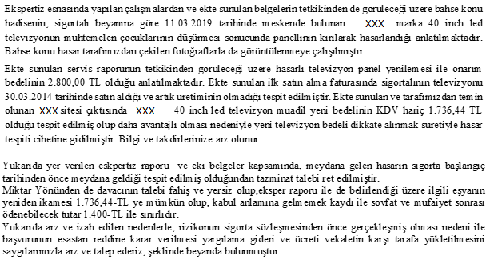

01.11.2019 Tarih ve K-2019/73322 Sayılı Hakem Kararı (Elektronik Cihaz)
1 BAŞVURU KONUSU UYUŞMAZLIK VE YARGILAMA USULÜNE İLİŞKİN BİLGİLER
1.1. Uyuşmazlık Konusu Olay ve Talep Karar bağlanmak üzere Hakeme tevdi edilmiş bulunan uyuşmazlığın konusu, başvuru sahibince beyan ve iddia edilen hasarın, sigorta şirketince tazmin edilmemesinden kaynaklandığı anlaşılmıştır. 1.2.Başvurunun Hakeme İntikaline ve İncelenmesine İlişkin Süreç
Dosya Hakem tarafından teslim alınarak yargılama başlanmıştır. Dosya içeriği üzerinde yapılan tetkik sonucunda, uyuşmazlığın mahiyeti ve dosya mevcudu itibariyle duruşma yapılmasına gerek olmadığı kanaatine varılmıştır.
Hakem tarafından sunulu evraklar üzerinde gerekli incelemeler yapılmıştır.
Dosya içeriği dikkate alınarak, uyuşmazlık hakkında 01.11.2019 tarihinde karara varılmış ve yargılamaya son verilmiştir.
2 TARAFLARIN ORTAYA KOYDUĞU MADDİ VE HUKUKİ İDDİALAR
2.1. Başvuru Sahibinin İddia, Delil ve Talepleri
Başvuru sahibi tarafından, 11.03.2019 tarihinde çocukların tarafından uzun süredir 6 yıldır kullandığımız televizyonumun kırılan ekranının tamir ücretinin karşılanması için XXX Sigortayı aradım. 12.03.2019 tarihinde eksper geldi resimleri çekti ve gitti. Daha sonra 13.03.2019 tarihinde faturaları ve dilekçe istediler gönderdim. Eksper bana poliçende elektronik hasar diye bir şey yok. Dosyanızı kapatıyoruz dediler. Poliçe sözleşmesinde belirtilen elektronik hasar tazminatı olan 2.500 TL talep ediyorum, şeklinde beyanda bulunmuştur.
2.2. Sigorta Kuruluşunun İddia, Delil ve Talepleri
Davalı taraf cevap dilekçesinde; Ekspertiz çalışmaları esnasında hasarlı televizyonun üzerinde biriken tozların bir kısmının silinerek temizlendiği ancak televizyon birleşim yerlerinde halen yoğun tozlanma mevcut olduğu gözlemlenmiştir. Şirketinizce tanzim olunan poliçenin önceki dönemi mevcut olmayıp vadesi ile sigortalının beyanına göre hadise tarihi arasında 11 gün gibi kısa bir süre mevcuttur. Televizyon üzerindeki tozlar göz önüne alındığında uzun zamandır kullanılmadığı, buna bağlı olarak hasarın poliçe vadesi öncesinde meydana gelme ihtimalinin yüksek olduğu kanaati oluşmuştur. Biilgi ve takdirlerinize arz olunur.


3.UYUŞMAZLIĞA UYGULANACAK HÜKÜMLER Uyuşmazlığın çözümü için 5684 Sayılı Sigortacılık Kanunu, Türk Ticaret Kanunu, Borçlar Kanunu, TKHK Hukuk Muhakemeleri Kanunu, Konut Sigortası Genel Şartları ve Sigorta Poliçesi hükümleri dikkate alınmıştır.
4.1 DEĞERLENDİRME, GEREKÇELİ KARAR 4.1 Değerlendirme
Uyuşmazlığa konu talep , XXX Sigorta AŞ tarafından 28.02.2019 -28.02.2020 dönemine ilişkin olarak beyana dayalı olarak XXX numaralı eşya paket sigorta poliçeye istinaden meydana gelen hasarın tazmin edilip edilmeyeceğine ilişkindir.
Başvuru sahibi sigortalı evinde meydana gelen hasarın tazmin edilmesi gerektiğini, aleyhine başvuru yapılan XXX Sigorta A.Ş. ise rizikonun sigorta sözleşmesinden önce gerçekleşmiş olması nedeni ile başvurunun esastan reddine karar verilmesi yargılama gideri ve ücreti vekaletin karşı tarafa yükletilmesini beyan etmiştir.
Dosyadaki bilgi ve belgelere göre tazminat hesaplanması ile ilgili ayrıca bir inceleme yapılmasına yer olmadığından yargılamaya son verilerek hüküm kurulmuştur
4.2. Gerekçeli Karar
Dosyaya sunulan poliçeden sözleşme ile Elektronik Cihaz Klozu ile belirlenen eşyalar sigorta teminatına alındığı anlaşılmıştır.
ELEKTRONİK CİHAZ KLOZU:
Sigortalı konut dahilinde bulunan masaüstü bilgisayarlar (yazıcıları dahil), televizyon, ev sinema ve ses sistemleri, müzik seti (portatif olanlar dahil), klimalar, kombiler, ısıtma veya soğutma sistemleri, elektronik kumandalı panjurlar, otomatik garaj kapıları, anten sistemleri, her türlü alarm ve güvenlik sistemleri, fırınlar, mikrodalga fırınlar, ocak, davlumbaz, temizleme cihazları (çamaşır makineleri, bulaşık makineleri, çevirmeli/vakumlamalı kurutucular) ve soğutucu cihazlar (buzdolabı, derin dondurucular) gibi elektrikli/elektronik cihazlar işler durumdayken veya aynı riziko adresi için temizleme, bakım, onarım değişiklik yapma ve yer değiştirme sırasında veya dururken önceden bilinmeyen ve ani olarak ortaya çıkan maddi ziyan ve hasarları Elektronik Cihaz Sigortası Genel ve aşağıda belirtilen özel şartlar çerçevesinde, poliçede belirtilen "elektronik cihaz" limitine kadar teminat altına alır.
Davalı vekili her ne kadar ekspertiz raporu ve eki belgeler kapsamında meydana gelen hasarın sigorta başlangıç tarihinden önce meydana gelmesi sebebiyle tazminatın reddedildiğini beyan etmiş iseler de; somut olaya bakıldığında, meydana gelen hasarın kasten ve iyi niyet kurallarına aykırı olarak beyan edildiği sabit olmamıştır. Bu durum karşısında rizikonun ihbar edilenden farklı şekilde gerçekleştiğini ispat külfeti sigortacıda bulunmaktadır. Sigortacı rizikonun ihbar edilenden farklı şekilde oluştuğunu meydana gelen hasarın sigorta teminat dışında olduğunu soyut iddialarla değil somut delillerle kanıtlamalıdır. Oysa sigortacı savunmalarını somut delillerle ispatlayamamıştır. .Sigorta Şirketi uyuşmazlığa ilişkin hasar konusunda soyut iddialara dayanmıştır.
Dosyada mevcut ekspertiz raporu, fiyat teklif formu incelenmiş ve başvuru sahibinin talebiyle bağlı kalarak 2.500TL. hasar bedelinin ödenmesine karar verilmiştir.
5. KARAR
Yapılan değerlendirmeler ve belirtilen gerekçeler neticesinde;
1) Başvuru sahibinin sigorta tazminatı ödenmesi ile ilgili talebinin kabulü ile 2.500TL sinin XXX Sigorta A.Ş.’ den tahsili ile başvuru sahibine verilmesine,
2)Başvuru sahibinin yaptığı 100TL başvuru ücretinin XXX Sigorta A.Ş. ’den tahsili ile başvuru sahibine verilmesine, kesin olarak karar verilmiştir. 01.11.2019
***
