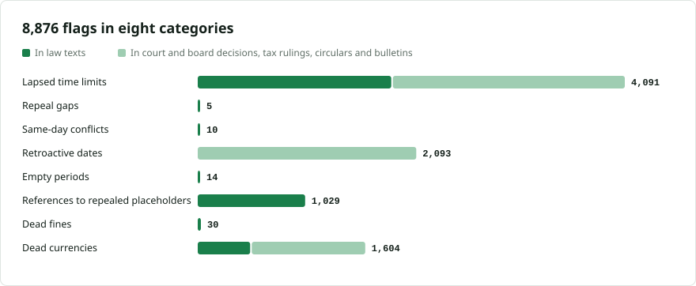

# Vulnerabilities in Turkish law

[Türkçe](README.md) · **English**

<picture>
<source media="(prefers-color-scheme: dark)" srcset="img/flags-by-category-dark.svg">

</picture>

The vulnerability detectors from [lexifina/global-law](https://github.com/lexifina/global-law/tree/main/vulnerabilities) look for mechanical mistakes in legislation: a rule applying "until" a date that has passed, a time limit extended only after it had run out, a provision repealed before its replacement took effect, two amendments to the same provision on the same day, a penalty for breaching an article that has been repealed. global-law's published list (9 November 2026) covered Türkiye with 382 flags from an earlier copy of this repository, so this is a run over this repository only, as it stood at commit [`9c398d4`](https://github.com/lexifina/turkey-law/commit/9c398d4944beae7bada4325f4dea413ed98feaac) on 15 November 2026, with the regulations, communiqués, presidential decisions, court and board decisions and municipal council decisions it now holds.

**In short:** the detectors raised 8,998 flags. A language model reviewed 319 of the strongest, arguing each one for and against; 28 survived: 12 lapsed time limits, 10 empty periods, 2 repeal gaps, 1 same-day conflict and 3 references to deleted provisions. Read by hand in this repository, seven of the 28 are no gap at all: the extending act applied from the day after the old date (four), or the Council of Ministers had extended the period in time, as the article allowed (three). Three come from how this repository rebuilt the history of its acts, five were misread by a detector (the three references to deleted provisions cite an article of another act), two are lawful (the date says which contracts qualify; a new period for set-off, opened on purpose), six are spent, four are decisions of the Competition Board, the Energy Market Regulatory Board and the Supreme Election Council and a tax ruling, and one looks like a real empty period: provisional Article 7 of the Sıvılaştırılmış Petrol Gazları (LPG) Piyasası Kanunu (5307) required the cost difference owed to ceramics producers to be paid by 31 March 2006, and Law No. 5522 moved the date to 31 March 2007 only from 24 June 2006, with no retroactive wording. Of the other 291 reviewed flags, 7 come from how this repository rebuilt the history of its acts, 6 are lawful, 2 were misread by a detector, 40 are decisions of the Competition Board, and 236 the model set aside, mostly time limits that ran out as planned. None of the 124 references to deleted provisions, read by hand, is a reference left behind: most cite an article of another act, and the rest point at articles this repository keeps inside another article's file or at an act's own amending articles, which no longer have a file of their own. The model does not review three categories; reading them by hand turned up four penalty provisions that still punish breaches of articles repealed since, and these look like real drafting mistakes. Article 68 of Law No. 1219 on the practice of medicine, rewritten by Law No. 5728 in 2008, fines nurses who exceed "the scope of practice shown in Article 64", which Law No. 6283 repealed in 1954. Article 55 of the same Law still fines midwives under Article 53, which Law No. 6514 repealed in 2014. Article 106 of the Forest Act (Law No. 6831) still punishes breaches of Articles 72 and 73, which Law No. 7139 rewrote and repealed in 2018. Article 67 of Law No. 6343 on veterinary practice still fines breaches of Article 43, repealed in 1963. Later, this will be formalised in Lean, similar to our work on [the US tax code](https://lexifina.com/blog/formalizing-the-us-tax-code) and [US case law](https://lexifina.com/blog/formalizing-all-us-case-law-in-lean).

A flag is a prompt to look, not legal advice, and nothing here has been tested in court.

## Flags by category

| Category | What it looks for | Flags | In law texts | Reviewed | Survived review |
| --- | --- | ---: | ---: | ---: | ---: |
| Lapsed time limits | Text still applying a rule "until" a date that has passed | 4,091 | 1,854 | 210 | 12 |
| Repeal gaps | A provision removed before its replacement took effect | 5 | 5 | 5 | 2 |
| Same-day conflicts | Two acts changing the same provision on the same day | 10 | 10 | 10 | 1 |
| Retroactive or pre-publication dates | A rule in force before it was made or published | 2,093 | 0 | 40 | 0 |
| Empty periods | A time limit extended by an act that took effect after it had run out | 14 | 14 | 14 | 10 |
| References to deleted provisions | A provision citing an article whose file is no longer in this repository | 124 | 124 | 40 | 3 |
| References to repealed placeholders | A provision citing an article that now reads only "Mülga" (repealed) | 1,029 | 1,029 | 0 | 0 |
| Dead fines | A penalty for breaching an article that has been repealed | 30 | 30 | 0 | 0 |
| Dead currencies | Amounts in currencies no longer in use | 1,602 | 501 | 0 | 0 |

"In law texts" counts laws, decree-laws (KHK), presidential decrees, decisions and circulars, by-laws (tüzükler), regulations, communiqués (tebliğler), Council of Ministers and Assembly decisions, Ottoman-era laws and municipal council decisions. The other flags are in court decisions, board decisions (the Competition Board, RTÜK and others), tax rulings and circulars, decisions of the Supreme Election Council and the Court of Accounts, and this repository's README, which this repository also holds and labels as not law. The search for lapsed time limits now reads Turkish, where the date comes before "kadar" ("31/12/2020 tarihine kadar", "31 Aralık 2020'ye kadar", "2020 yılı sonuna kadar"), and so does the search for time limits extended after they had run out. Of the 6,550 places in this repository where "kadar", "dek" or "değin" follows a past date or year, it reads 4,105, the end of the day or a time after the date among them ("31/8/2018 günü sonuna kadar", "19/1/2018 günü saat 23.59'a kadar"); it still misses 735 that set a time limit in other words, 136 of them in law texts: a weekday between the date and "günü saat" or "günü sonuna" ("22 Eylül 2009 Salı günü saat 24:00'a kadar", 372), the end of office hours ("31/5/2023 günü mesai bitimine kadar", 164), a month of a year ("2019 yılı Şubat ayı sonuna kadar", 78), a weekday alone ("Cuma gününe kadar", 67), "(bu tarih dâhil)" between the date and "kadar" (28), a time after "tarihinde" or "tarihi ve" (19), the end of a fiscal year ("1982 mali yılı sonuna kadar", 6) and "tarihi bitimine" (1). Of the other 1,710, 300 name a year only ("2023 yılına kadar") and the rest were not sorted; in a sample, most are not time limits ("1801 - 2000 cm³ e kadar", "tarihinden ödeme tarihine kadar"). The search for dead currencies takes "lira" with its Turkish endings ("5.000 liradan", "7.255.400 liralık") and other currency names only as whole words, so words such as "intikal", "intifa" and Marcoussis no longer match. A repealed article keeps its file here, reading only "(Mülga: ...)", so a reference to it counts as a reference to a repealed placeholder; a reference to a deleted provision cites an article whose file this repository no longer holds. The search for stale amounts, duplicate numbering and publisher notes found nothing.

*Edge cases: the five likely mistakes, the reviewed flags grouped by what they turned out to be, and what the other flags are, the references to deleted provisions among them, in [EDGE-CASES.en.md](EDGE-CASES.en.md).*

## Problems found in this repository

- **Articles missing from earlier texts:** 103 article files that an amending act removes in this history come back later, in 11 acts. For the five the detector ranked, the publisher's in-force table lists that act as amending the article, not repealing it: Articles 14 to 16 of the Engelliler Hakkında Kanun (5378) have no text from 3 May 2013 to 19 February 2014, Article 5 of the Kaçakçılıkla Mücadele Kanunu (5607) from 11 April 2013 to 15 April 2020, and Article 78 of the Sosyal Sigortalar ve Genel Sağlık Sigortası Kanunu (5510) from 8 May 2008 to 23 May 2015 ([Edge cases](EDGE-CASES.en.md)).
- **Today's text dated too early:** where the publisher kept no text in between, this history credits the current text to the last act whose amendment note it carries, on that act's date. Provisional Article 6 of the Elektrik Piyasası Kanunu (6446) reads "31/12/2030", and has the rates Law No. 7590 set in July 2026, from [10 April 2023](https://github.com/lexifina/turkey-law/commit/09f3a1d4d3f420d80c4f5ce9e6092c96e10f363f), credited to Law No. 7451; Article 8 of Law No. 5346 goes from "31/12/2015" to "31/12/2030" on [24 July 2025](https://github.com/lexifina/turkey-law/commit/51329ea9b93296bd8cc4f3ef5d9ded04d7fa7802) (Law No. 7554), without Law No. 7257's change to "31/12/2025" in 2020; provisional Article 12 of Law No. 6111 reads "1/1/2020" from [9 January 2016](https://github.com/lexifina/turkey-law/commit/6cc091daccb636dbf7672e211906b88dd0c3dfcc), though Law No. 6656 wrote "1/1/2017" and Law No. 7166 changed "1/1/2019" to "1/1/2020" in 2019.
- **The rest of an act in one file:** in at least 13 acts, the text from one article to the end of the act is a single file, for example the Harçlar Kanunu (492) from Article 13, the Türk Silahlı Kuvvetleri Personel Kanunu (926) from Article 77 (312 article headings in [one file](https://github.com/lexifina/turkey-law/blob/9c398d4944beae7bada4325f4dea413ed98feaac/law/1967/926/madde-77.md)) and the Taşıt Kanunu (237) from Article 10. Detectors read such a file as one article (14 of the 30 dead fines, 26 of the 124 references to deleted provisions).
- **Articles inside the file of the article before them:** at least 18 articles in 8 acts have no file of their own, because a footnote mark follows the number in their heading ("Madde 15[14][15] –"); their text sits at the end of the previous article's file. Ten are in the Gümrük Kanunu (4458), among them Article 15 ([in the file of Article 14](https://github.com/lexifina/turkey-law/blob/9c398d4944beae7bada4325f4dea413ed98feaac/law/1999/4458/madde-14.md)) and Article 7, whose own files were removed on 28 October 2026, as was that of Article 3 of Law No. 2022; the others include Article 74 of the Köy Kanunu (442) and Article 72 of Law No. 6552. A reference to such an article counts as a reference to a deleted provision (7 of the 124).
- **Stray numbers in earlier texts:** lines holding only a number sit inside articles, such as "9946" in provisional Article 4 of the İskân Kanunu (5543) from 29 May 2013 until 28 October 2026, and "10539" in the 2010 text of Article 9 of the Biyogüvenlik Kanunu (5977).

## Files

| File | What it holds |
| --- | --- |
| [data/flags.csv](data/flags.csv) | Every flag, one row per provision and issue |
| [data/reviewed.csv](data/reviewed.csv) | The 319 flags the model reviewed, with its verdict and reason |
| [data/by_category.csv](data/by_category.csv) | The counts in the table above |
| [tools/](tools/) | The scripts that made this run |

Columns: `category` and `category_tr` (the category in English and Turkish), `detector`, `kind` (`law` or `other`), `path` (the file in this repository; for a retroactive date, the first file of the act or decision), `date` (the date the flag turns on; for a reference to a deleted provision, the last date its target is in the record), `reference` (the act or line involved), `summary`, `score` (the detector's ranking, 0 to 1), `review` (`artefact`, `lawful` or `candidate_defect`), `survives_rebuttal`, `review_note` (the model's reason, in English), `url` (the provision at the commit that was read, under its folder since act folders were renamed on 10 November 2026, or, for a retroactive date, the latest commit credited to the act or decision).

## How it was made

- **Detectors:** global-law's [vulnerabilities/scripts](https://github.com/lexifina/global-law/tree/main/vulnerabilities/scripts), run on this repository at commit `9c398d4`. global-law replays this repository only up to an earlier commit, so the history table the detectors read was built from this repository's own commits (the author, the act that made each change, and the `In-force` and `Kind` trailers; a first text marked `as-enacted`, `enacted`, `consolidated` or `current-text` counts as law, as an amendment does). The detectors were then run again with fixes that read Turkish dates written before "kadar", also with the end of the day or a time after them, that take "lira" with its Turkish endings and other currency names only as whole words; the second time, only the strong flags not yet reviewed went to the model. This repository moved its act folders on 10 November 2026, and every earlier commit names a file by its old folder, so each act's history was split at the move and the search for references to deleted provisions read nothing; the detectors were run once more with each path mapped to its folder since the move, keeping every review already made.
- **Model review:** gpt-5.4-mini, the 40 strongest flags per category, and for lapsed time limits also the 40 strongest in law texts; a pass after a fix to the sharded scans reviewed 41 more lapsed time limits that tied on score with those, and after the folder move, flags whose paths had changed went to the model again (210 lapsed time limits reviewed in all); one pass says whether a flag is real, a second argues that it is not. Categories with fewer flags, the 14 empty periods among them, were reviewed in full. The model does not review references to repealed placeholders, dead fines or dead currencies. global-law's own list used a different model.
- **Hand check:** every reviewed flag in the repeal gaps, same-day conflicts and retroactive dates, every flag that survived the model, and three empty periods that survived it in an earlier run were read in this repository's history and texts; the other 236 were read in the passage the detector quoted. For the empty periods, the commencement articles of the extending acts were read in the Resmî Gazete (Laws No. 5522, 6656, 7166, 7257 and 7590, and Council of Ministers Decision 2015/8317); this repository holds Law No. 5838 itself; for Law No. 5568, only the publisher's in-force table was read. Of the categories the model does not review, all 30 dead fines were read, 22 of the references to repealed placeholders in articles, all 124 references to deleted provisions together with the files they point to, and the dead currencies by the word matched. The four dead fines rest on the publisher's consolidated text, its amendment notes and its in-force tables; this repository does not hold Laws No. 5728, 6514 and 7139 themselves, so they still need the Resmî Gazete.

To report a correction, open an issue with the provision and an official source.

## Licence

The lists and notes are Lexifina's, dedicated to the public domain under CC0 1.0, like the rest of this repository's own contributions. Quoted law text is as the Mevzuat Bilgi Sistemi and the other official sources publish it, which Article 31 of Law No. 5846 leaves free to reuse; see [LICENSE](../LICENSE).
