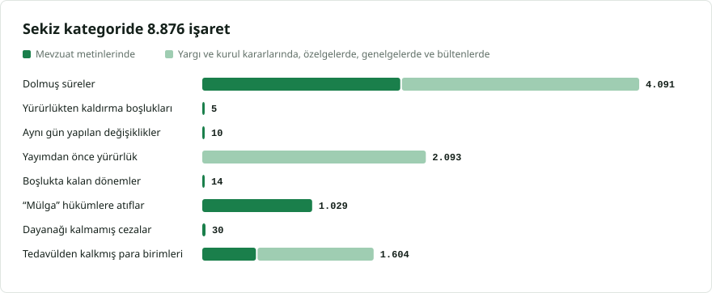

# Türk mevzuatındaki zafiyetler

**Türkçe** · [English](README.en.md)

<picture>
<source media="(prefers-color-scheme: dark)" srcset="img/flags-by-category-dark.tr.svg">

</picture>

[lexifina/global-law](https://github.com/lexifina/global-law/tree/main/vulnerabilities) projesinin zafiyet dedektörleri mevzuattaki mekanik hataları arar: geçmiş bir tarihe “kadar” uygulanmaya devam eden bir kural, yerine gelen hüküm yürürlüğe girmeden yürürlükten kaldırılan bir hüküm, aynı hükümde aynı gün yapılan iki değişiklik, yürürlükten kaldırılmış bir maddeye aykırılığı cezalandıran bir hüküm. global-law'un 9 Kasım 2026'da yayımladığı liste Türkiye'yi bu deponun daha eski bir kopyası üzerinden 382 işaretle kapsıyordu; bu nedenle burada yalnızca bu depo, 15 Kasım 2026 tarihli [`9c398d4`](https://github.com/lexifina/turkey-law/commit/9c398d4944beae7bada4325f4dea413ed98feaac) commit'indeki hâliyle ve şimdi içerdiği yönetmelikler, tebliğler, Cumhurbaşkanı kararları, yargı ve kurul kararları ile belediye meclisi kararlarıyla birlikte taranmıştır.

**Kısaca:** dedektörler 4.461 işaret üretti. Bir dil modeli bunların en güçlü 56'sını inceledi ve her biri için lehte ve aleyhte gerekçeleri tarttı; hiçbiri incelemeyi geçmedi. Bu depoda elle okunduğunda 56 işaretin 10'u bu deponun düzenlemelerin geçmişini yeniden kurma biçiminden kaynaklanıyor, 5'i hukuka uygun, 41'i ise hiç mevzuat değil (Rekabet Kurulunun 40 kararı ve bu deponun README dosyası). Model üç kategoriyi incelemiyor; bunlar elle okunduğunda, sonradan yürürlükten kaldırılmış maddelere aykırılığı hâlâ cezalandıran dört ceza hükmü ortaya çıktı ve bunlar gerçek düzenleme hatalarına benziyor. 1219 sayılı Tababet ve Şuabatı San'atlarının Tarzı İcrasına Dair Kanunun 2008'de 5728 sayılı Kanunla yeniden düzenlenen 68 inci maddesi, “64 üncü maddede gösterilen icrayı sanat hududunu” aşan hastabakıcılara idari para cezası öngörüyor; oysa 64 üncü madde 1954'te 6283 sayılı Kanunla yürürlükten kaldırılmıştı. Aynı Kanunun 55 inci maddesi, 2014'te 6514 sayılı Kanunla yürürlükten kaldırılan 53 üncü maddeye dayanarak ebelere ceza öngörmeye devam ediyor. 6831 sayılı Orman Kanununun 106 ncı maddesi, 2018'de 7139 sayılı Kanunla yeniden düzenlenen 72 nci ve yürürlükten kaldırılan 73 üncü maddelere aykırılığı hâlâ cezalandırıyor. 6343 sayılı Kanunun 67 nci maddesi de 1963'te yürürlükten kaldırılan 43 üncü maddeye aykırılık için para cezası öngörüyor. İleride bunlar, [ABD vergi kanunu](https://lexifina.com/blog/formalizing-the-us-tax-code) ve [ABD içtihadı](https://lexifina.com/blog/formalizing-all-us-case-law-in-lean) üzerine yaptığımız çalışmalara benzer biçimde Lean'de biçimselleştirilecek.

Bir işaret, yakından bakmak için bir uyarıdır; hukuki danışmanlık değildir ve buradakilerin hiçbiri yargı önünde sınanmamıştır.

## Kategorilere göre işaretler

| Kategori | Ne arar | İşaret | Mevzuat metinlerinde | İncelenen | İncelemeyi geçen |
| --- | --- | ---: | ---: | ---: | ---: |
| Dolmuş süreler | Geçmiş bir tarihe “kadar” bir kuralı uygulamaya devam eden metin | 1 | 0 | 1 | 0 |
| Yürürlükten kaldırma boşlukları | Yerine gelen hüküm yürürlüğe girmeden kaldırılan hüküm | 5 | 5 | 5 | 0 |
| Aynı gün yapılan değişiklikler | Aynı hükmü aynı gün değiştiren iki düzenleme | 10 | 10 | 10 | 0 |
| Yayımdan önce yürürlük | Kabul edilmeden ya da yayımlanmadan önce yürürlüğe giren kural | 2.093 | 0 | 40 | 0 |
| “Mülga” hükümlere atıflar | Artık yalnızca “Mülga” ibaresini taşıyan bir maddeye atıf yapan hüküm | 1.029 | 1.029 | 0 | 0 |
| Dayanağı kalmamış cezalar | Yürürlükten kaldırılmış bir maddeye aykırılık için öngörülen ceza | 30 | 30 | 0 | 0 |
| Tedavülden kalkmış para birimleri | Artık kullanılmayan para birimleriyle ifade edilen tutarlar | 1.293 | 418 | 0 | 0 |

“Mevzuat metinlerinde” sütunu kanunları, kanun hükmünde kararnameleri, Cumhurbaşkanlığı kararnamelerini, Cumhurbaşkanı kararlarını ve Cumhurbaşkanlığı genelgelerini, tüzükleri, yönetmelikleri, tebliğleri, Bakanlar Kurulu ve TBMM kararlarını, Osmanlı dönemi kanunlarını ve belediye meclisi kararlarını kapsar. Diğer işaretler yargı kararlarında, kurul kararlarında (Rekabet Kurulu, RTÜK ve diğerleri), özelgelerde ve sirkülerlerde, Yüksek Seçim Kurulu ile Sayıştay kararlarında ve bu deponun README dosyasındadır; depo bunları da içerir ve mevzuat dışı olarak ayırır. Dolmuş süre araması mevzuat metinlerinde hiçbir şey bulmadı: arama “until” türünden bir sözcüğün ardından gelen tarihi okur, Türkçede ise tarih önce gelir (“31/12/2020 tarihine kadar”); bu yüzden hiçbir Türkçe cümleyle eşleşmedi ve aynı nedenle süresi dolduktan sonra uzatılan bir süre de bulmadı. Yürürlükten kaldırılan bir madde bu depoda dosyasını korur ve yalnızca “(Mülga: ...)” ibaresini taşır; bu nedenle ona yapılan atıf, silinmiş bir hükme değil “Mülga” bir hükme atıf olarak sayılır. Güncellenmemiş tutar, mükerrer numaralandırma ve yayımcı notu aramaları hiçbir şey bulmadı.

*Sınır durumlar: dört olası hata, incelenen 56 işaretin neye dönüştüğüne göre gruplandırılmış hâli ve diğer işaretlerin ne olduğu [EDGE-CASES.md](EDGE-CASES.md) dosyasındadır.*

## Bu depoda bulunan sorunlar

- **Önceki metinlerde eksik maddeler:** bu geçmişte bir değişiklik düzenlemesinin kaldırdığı 103 madde dosyası, 11 düzenlemede daha sonra geri gelir. Dedektörün sıraladığı beş durumda yayımcının yürürlük tablosu ilgili düzenlemeyi maddeyi yürürlükten kaldıran değil, değiştiren düzenleme olarak gösterir: 5378 sayılı Engelliler Hakkında Kanunun 14 ilâ 16 ncı maddelerinin 3 Mayıs 2013'ten 19 Şubat 2014'e, 5607 sayılı Kaçakçılıkla Mücadele Kanununun 5 inci maddesinin 11 Nisan 2013'ten 15 Nisan 2020'ye, 5510 sayılı Sosyal Sigortalar ve Genel Sağlık Sigortası Kanununun 78 inci maddesinin 8 Mayıs 2008'den 23 Mayıs 2015'e kadar metni yoktur ([sınır durumlar](EDGE-CASES.md)).
- **Bir düzenlemenin geri kalanı tek dosyada:** en az 13 düzenlemede bir maddeden düzenlemenin sonuna kadar olan metin tek bir dosyadır; örneğin 492 sayılı Harçlar Kanununda 13 üncü maddeden, 926 sayılı Türk Silahlı Kuvvetleri Personel Kanununda 77 nci maddeden ([tek dosyada](https://github.com/lexifina/turkey-law/blob/9c398d4944beae7bada4325f4dea413ed98feaac/law/1967/926/madde-77.md) 312 madde başlığı), 237 sayılı Taşıt Kanununda 10 uncu maddeden itibaren. Dedektörler böyle bir dosyayı tek bir madde gibi okur (dayanağı kalmamış 30 cezanın 14'ü).
- **Önceki metinlerde kalmış sayılar:** maddelerin içinde yalnızca bir sayıdan oluşan satırlar vardır; örneğin 5543 sayılı İskân Kanununun geçici 4 üncü maddesinde 29 Mayıs 2013'ten 28 Ekim 2026'ya kadar “9946”, 5977 sayılı Biyogüvenlik Kanununun 9 uncu maddesinin 2010 metninde “10539”.

## Dosyalar

| Dosya | İçeriği |
| --- | --- |
| [data/flags.csv](data/flags.csv) | Her işaret, hüküm ve sorun başına bir satır |
| [data/reviewed.csv](data/reviewed.csv) | Modelin incelediği 56 işaret, kararı ve gerekçesiyle birlikte |
| [data/by_category.csv](data/by_category.csv) | Yukarıdaki tablodaki sayılar |
| [tools/](tools/) | Bu taramayı yapan betikler |

Sütunlar: `category` ve `category_tr` (kategori İngilizce ve Türkçe), `detector`, `kind` (`law` ya da `other`), `path` (bu depodaki dosya; yayımdan önce yürürlük işaretlerinde düzenlemenin ya da kararın ilk dosyası), `date` (işaretin dayandığı tarih), `reference` (ilgili düzenleme ya da satır), `summary`, `score` (dedektörün sıralaması, 0 ile 1 arasında), `review` (`artefact`, `lawful` ya da `candidate_defect`), `survives_rebuttal`, `review_note` (modelin gerekçesi, İngilizce), `url` (okunan commit'teki hüküm, düzenleme klasörleri 10 Kasım 2026'da yeniden adlandırıldığından bugünkü klasöründe; yayımdan önce yürürlük işaretlerinde düzenlemeye ya da karara atfedilen son commit).

## Nasıl yapıldı

- **Dedektörler:** global-law'un [vulnerabilities/scripts](https://github.com/lexifina/global-law/tree/main/vulnerabilities/scripts) betikleri, bu depo üzerinde `9c398d4` commit'inde çalıştırıldı. global-law bu depoyu yalnızca daha eski bir commit'e kadar yeniden oynatır; bu yüzden dedektörlerin okuduğu geçmiş tablosu bu deponun kendi commit'lerinden kuruldu (yazar, yani değişikliği yapan düzenleme, ile `In-force` ve `Kind` trailer'ları; `as-enacted`, `enacted`, `consolidated` ya da `current-text` olarak işaretlenmiş bir ilk metin, bir değişiklik gibi mevzuat sayılır).
- **Model incelemesi:** gpt-5.4-mini, her kategoride en güçlü 40 işaret ve dolmuş sürelerde ayrıca mevzuat metinlerindeki en güçlü 40 işaret; ilk geçiş işaretin gerçek olup olmadığını söyler, ikinci geçiş gerçek olmadığını savunur. Daha az işaret içeren kategoriler bütünüyle incelendi. Model “Mülga” hükümlere atıfları, dayanağı kalmamış cezaları ve tedavülden kalkmış para birimlerini incelemez. global-law'un kendi listesi başka bir model kullanmıştı.
- **Elle denetim:** incelenen her işaret bu deponun geçmişinde ve metinlerinde okundu. Modelin incelemediği kategorilerden dayanağı kalmamış 30 cezanın tamamı ve maddelerdeki atıflardan 22'si okundu; tedavülden kalkmış para birimleri eşleşen sözcüğe göre ayrıldı. Dört açık durum yayımcının işlenmiş metnine, değişiklik notlarına ve yürürlük tablolarına dayanır; bu depo 5728, 6514 ve 7139 sayılı Kanunların kendi metinlerini içermediğinden bu durumların Resmî Gazete'de de doğrulanması gerekir.

Bir düzeltme bildirmek için hükmü ve resmî bir kaynağı belirterek bir issue açın.

## Lisans

Listeler ve notlar Lexifina'nındır ve bu deponun diğer kendi katkıları gibi CC0 1.0 kapsamında kamu malına bırakılmıştır. Alıntılanan mevzuat metni Mevzuat Bilgi Sistemi'nin ve diğer resmî kaynakların yayımladığı gibidir ve 5846 sayılı Kanunun 31 inci maddesi uyarınca serbestçe kullanılabilir; bkz. [LICENSE](../LICENSE).
